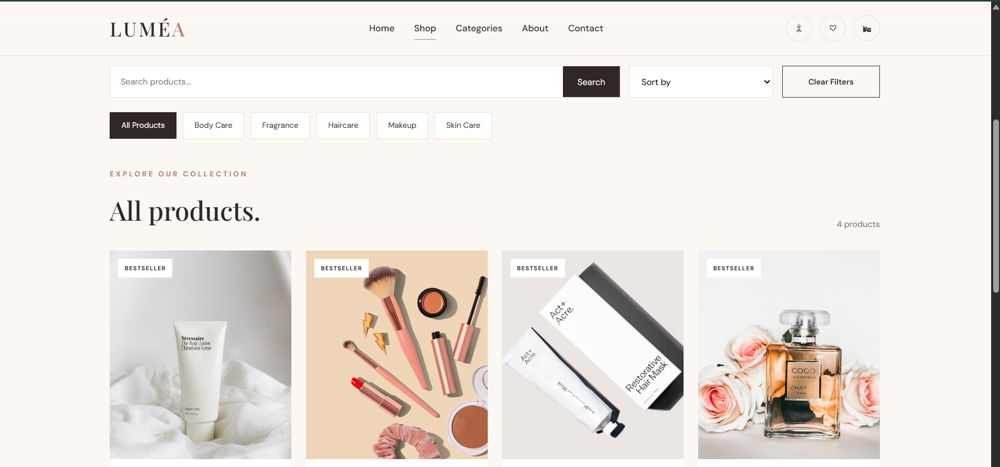
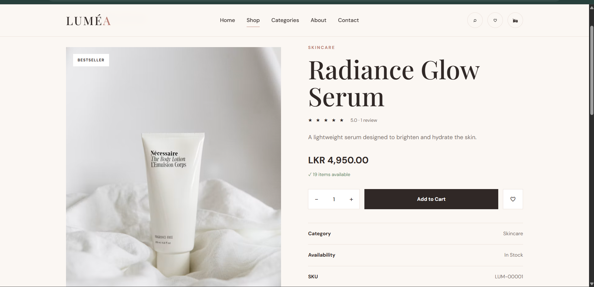
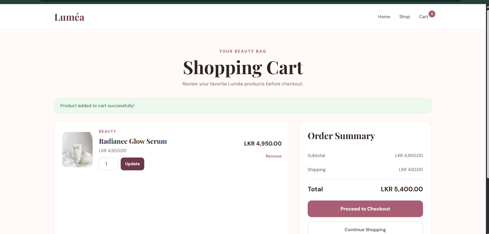
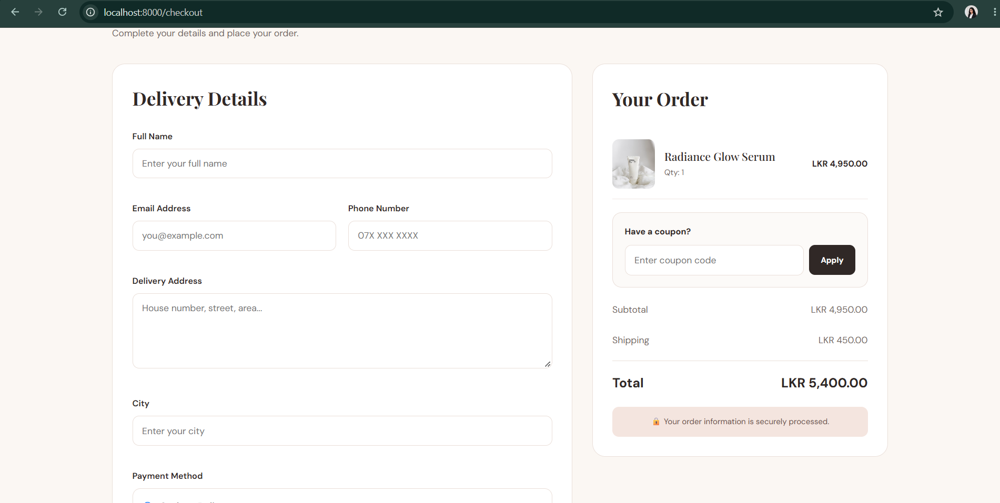
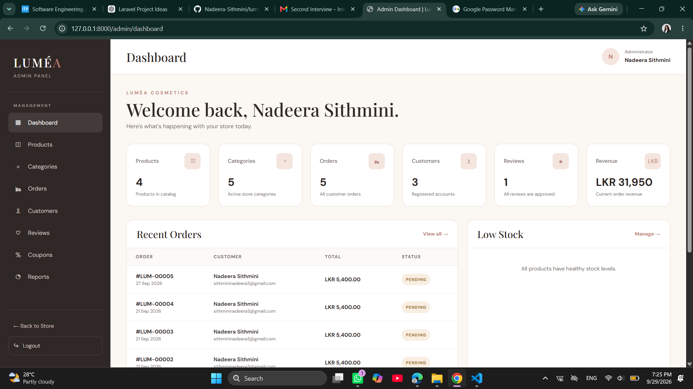
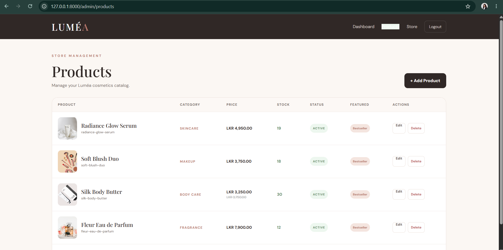
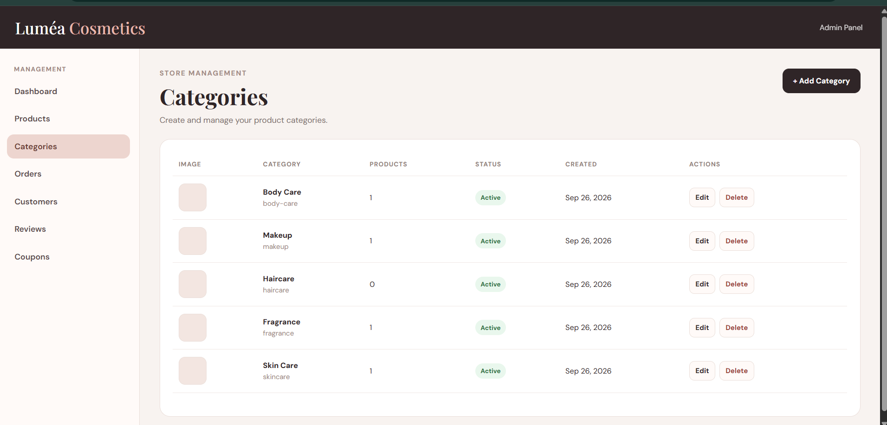
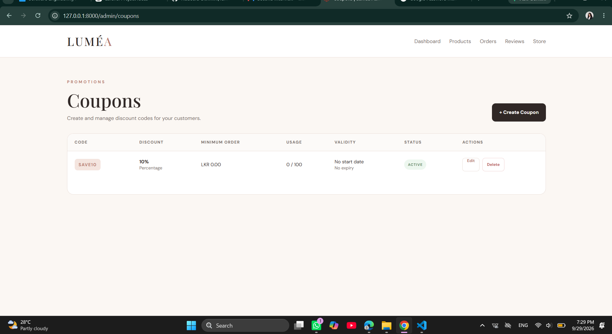
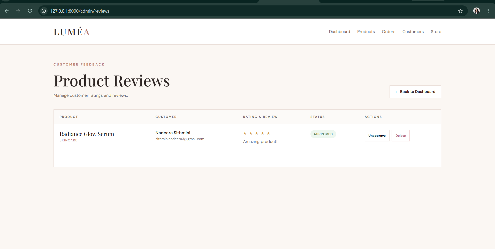
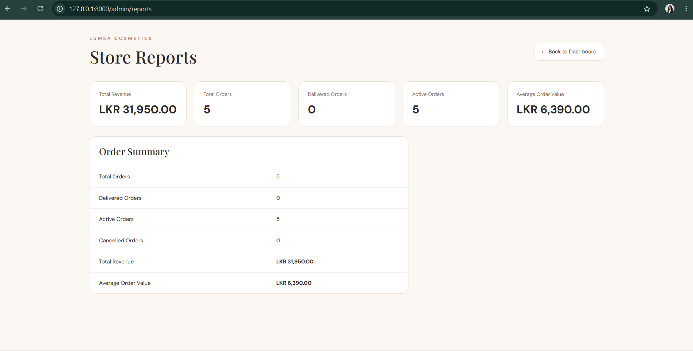

# 💄 Luméa Cosmetics — E-Commerce Web Application

A full-stack cosmetics e-commerce web application built with **PHP, Laravel, MySQL, Blade, JavaScript and Vite**, designed to provide a complete online shopping experience with a dedicated role-based admin panel.

Built as a personal/portfolio project to explore full-stack web development with Laravel, MVC architecture, relational databases, authentication, e-commerce workflows and responsive UI design.

---

## 📸 Screenshots

### 🏠 Customer Experience

Home Page | Shop Page | Product Details
--- | --- | ---
 |  | 

### 🛒 Shopping Experience

Shopping Cart | Checkout
--- | ---
 | 

### 🔐 Admin Panel

Dashboard | Products | Categories
--- | --- | ---
 |  | 

Coupons | Reviews | Reports
--- | --- | ---
 |  | 

---

## ✨ Features

### 🛍️ Customer

- Product browsing and product details
- Search, category filtering and sorting
- Shopping cart and quantity management
- Checkout and order placement
- Coupon application and discount calculation
- Customer registration and login
- Order history
- Wishlist
- Product ratings and reviews
- Responsive mobile-friendly interface

### 🔐 Admin

- Admin dashboard with store statistics
- Product CRUD management
- Category CRUD management
- Product-category relationships
- Order management and status updates
- Customer management
- Review management
- Coupon management
- Store reports
- Low-stock product monitoring
- Role-based admin access control

---

## 🔐 Authentication & Role-Based Access

The application separates customer and administrator functionality using authentication and role-based middleware.

```text
User Login
    ↓
Authentication
    ↓
Check User Role
    ↓
 ┌───────────────┐
 │               │
Customer       Admin
 │               │
 ↓               ↓
Store          Admin Panel
Features
